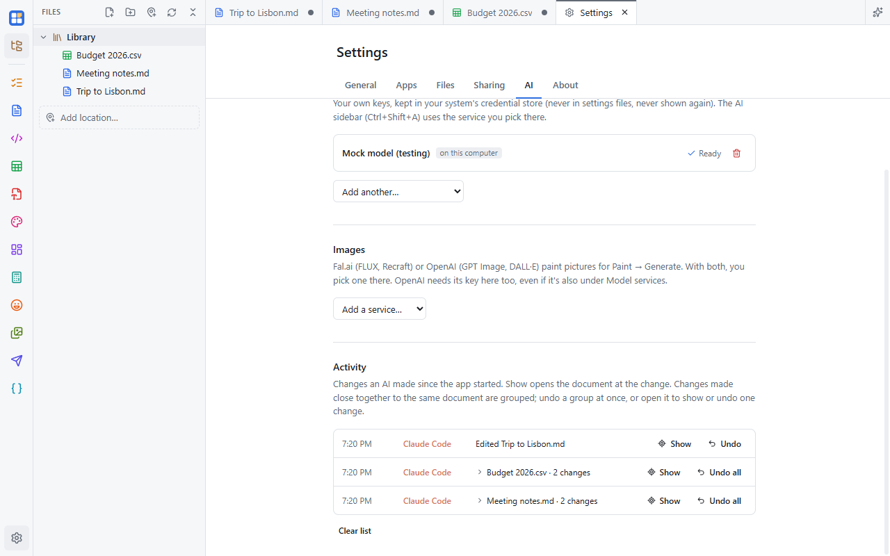

Whether a change comes from the [AI sidebar](/docs/ai/sidebar/) or from an [agent connected over MCP](/docs/ai/agents/),
Simple Desk records it, lets you jump to it, and lets you take it back. You can always see who changed what and where,
and nothing an AI does has to be permanent.

## What gets recorded

Every change an AI makes is recorded:

- creating, overwriting or editing a file: Markdown, JSON, HTML or any text file;
- editing a table (CSV, Excel or OpenDocument), a board, a PDF, a picture in Paint, a meme or a graph;
- adding, updating, completing, reopening or deleting to-dos;
- making new files with the Images tools.

Reading isn't recorded. When an AI opens, searches or reads your files, nothing is added to the list. Actions that were
refused, that you didn't allow, or that failed aren't recorded either, because nothing changed.

## Who did it

Each AI has a name and a color, used everywhere its work shows up:

- **In the sidebar**, the AI is named after its model service (for example "Claude" or "GPT").
- **Connected agents** are named after the program: Claude, Claude Code, Codex, Cursor, or the name the program gives
  itself.

When an AI edits a document that's open, you see where, for a few seconds: in Markdown, JSON and HTML a caret in its
color with its name on it, in a table the cells it changed, on a board an outline with its name around what it changed.
That way you can watch an agent work in the same document as you. To find a change again later, use **Show**.

## The Activity list

**Settings → AI** has an **Activity** section below both the API and MCP tabs. It lists every change made since the
app started, newest first. Each row shows:

- the time;
- who made the change, in their color (point at the name to see whether it came from the AI sidebar or a connected
  agent);
- what changed, like "Edited plan.md" or "Completed 3 to-dos". Point at it to see the exact action and its settings.

**Grouping.** A run of changes by the same AI to the same document becomes one row, like "Edited plan.md · 22 changes",
with the time range. A change stays in the run if it came within three minutes of the one before. **Undo all** takes back
the whole group. Click the row to open it and undo single changes.

The list lives in memory. It's cleared when you quit Simple Desk, keeps the last 500 changes, and **Clear list** empties
it at any time. Clearing the list doesn't touch your files.

## Showing a change

**Show** takes you to a change: it's on each chip in the sidebar, on each row of the Activity list (for a group, the
latest change), and on each single change when you open a group. Simple Desk brings the document's tab to the front,
or opens the file again if you closed it, and points at what changed:

| What the AI changed | What Show does |
|---|---|
| Markdown, JSON, HTML or another text file | Selects the text the AI wrote, with its name on the caret again. It finds the text even after you kept typing around it. If the document is in Preview (or JSON's tree view), it switches to a view with the text first. |
| A table | Selects the changed cells and tints them in the AI's color. If a filter hides them, the filter is cleared. After deleted rows, it selects the row now in their place. |
| A board | Selects what changed and centers the board on it, zooming out if it doesn't fit. After a delete, it shows where the deleted elements were. |
| A PDF | Goes to the page, and for added text, to the spot on the page. |

If the file wasn't open when the AI changed it, Show opens it at where the change was made. A change you've undone has
no Show.

## Seeing what changed

**Changes** shows exactly what a change did. It's on each chip in the sidebar, on each row of the Activity list (for a
group, every change in it, oldest first), and on each single change when you open a group.

- **Text files** (Markdown, JSON, HTML and other text): the removed lines in red and the added lines in green, with line
  numbers and the changed words highlighted, plus a few unchanged lines around them.
- **Tables**: changed cells as before and after, and the rows and columns that were added or removed. A sort says how
  many rows it reordered.

The dialog also has **Show in document** and **Undo**. Like the list, changes are kept until you quit Simple Desk.

## Who wrote this text

In a Markdown document, put the caret in text an AI wrote and the status bar at the bottom says who and when, like
"Written by Claude · 3:42 PM". **View change** opens that change. In the preview, it says "Changed by …" for the
paragraph you're in. **Highlight AI text** in the status bar tints everything an AI wrote in its color.

Text you type inside an AI's paragraph stays yours, and undoing an AI's change removes its marks. Simple Desk knows
who wrote what only while the tab stays open. It isn't saved in the file, and it covers only edits made while the
document was open.

## Undoing a change

There are two places to undo:

- **In the sidebar**, every change shows as a chip under the AI's reply. Its **Undo** button takes back just that change.
- **In Settings → AI → Activity**, use **Undo** on a single change or **Undo all** on a group. Undo all goes newest
  first, so each step applies to the text it was made on.

An undone change is struck through and marked **Undone**. What Undo does depends on what was changed:

| What the AI changed | What Undo does |
|---|---|
| A document open in a tab | Takes back only that edit, even after you or the AI kept typing elsewhere in the document. The tab shows unsaved changes; save as usual. |
| A file that wasn't open | Puts back the whole file as it was before the AI wrote it. Anything changed in that file since then is replaced too. |
| A new file the AI created | Moves the file to the Recycle Bin (the Trash on macOS and Linux), so you can still get it back. |
| To-dos | Puts back just the to-dos that change touched, as they were before. Your other to-dos aren't affected. |
| A picture in Paint | An edit to an open picture is taken back as long as nothing changed after it; otherwise use **Ctrl+Z** in Paint. A picture that wasn't open is put back as it was. A generated picture arrives as a selection you can move: keep it, or press **Ctrl+Z**. |

**Ctrl+Z works too.** In an open document, each AI edit is its own step in the editor's undo history, so pressing
Ctrl+Z right after an AI edit takes it back. Use the Undo button when you want one AI edit gone and everything after it
kept.

**Keep the document open** to undo an edit made in a tab. If you close the tab first, its edit can't be undone from the
list any more (you'll see "The document was closed"). Edits made to files on disk can still be undone after closing.

## Asking first

Some changes wait for your OK instead of being undone afterwards:

- **Overwriting a file** or **deleting to-dos** always opens an "Allow … to continue?" dialog, with the AI's name and
  what it wants to do. **Don't allow** stops the action, and the AI is told you declined.
- For connected agents, **Settings → AI → MCP** lets you choose what agents may do: read only, read and edit, or
  full. You can also turn on **Ask me before every edit**, so each change waits for your OK.

See [Connecting agents](/docs/ai/agents/#permissions) for the agent settings.
