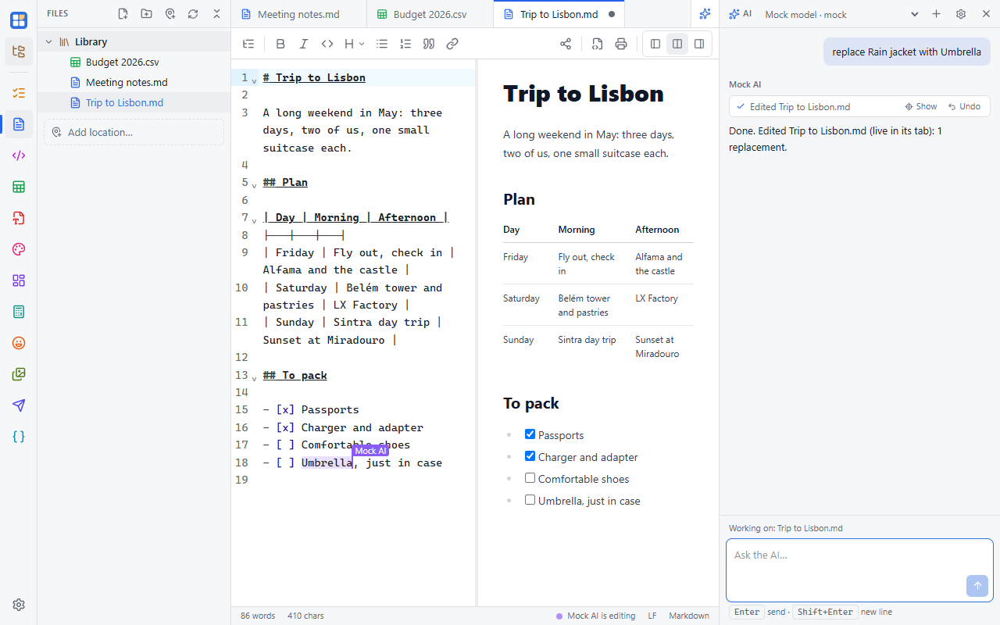

AI in Simple Desk works like a fast collaborator: its edits appear live in your open documents, with its name on the
cursor, and each one can be undone on its own. It's optional and does nothing until you set up a model service.

## Set up a model

Open **Settings → AI → API → Model services** and add one:

- **Anthropic** (Claude), **OpenAI**, **OpenRouter** (Gemini and many others) or **xAI** (Grok), with your own API key;
- **Ollama** running on your computer, so nothing leaves it;
- or any **OpenAI-compatible** server.

**Test** checks the key and loads the service's model list. The model box lists every model; type to narrow it down, or
type any model id.

Your keys are stored in your system's credential store (Windows Credential Manager, macOS Keychain, or GNOME Keyring /
KWallet on Linux), not in a settings file, and each key is only ever sent to its own service. Usage is billed by the
service to your account.

## Use the sidebar

Open it with **Ctrl+Shift+A**, the sparkle button at the top right, or **Ctrl+K → Ask AI**. It knows which document you're
looking at ("Working on: …"). It can:

- answer questions about the document and summarize it;
- edit text, Markdown and HTML with focused changes (find and replace, insert), never a blind rewrite;
- read and change JSON by path, and format, minify or sort it;
- query and edit tables, including Excel and OpenDocument sheets: cells, rows, columns, sorting;
- add, move and comment on things on a board, and look at a picture of it;
- plot and analyze graphs, and work out calculations;
- read PDFs, fill in forms, add text, and rotate, delete, move or extract pages;
- edit pictures (resize, crop, shapes, text, colors) and generate new ones;
- fill in memes, edit API collections and send their requests, and convert images or make icon sets;
- create documents, browse and search your library;
- add, update and complete to-dos.

It uses each app's own tools, so it works on the document the way the app does. A file that's open in a tab changes in
front of you.

## Undo, and asking first

Every change shows as a chip with **Show** and **Undo**. **Show** opens the document at the change; **Undo** takes back
just that change, even after you've kept typing elsewhere.
Overwriting a file or deleting to-dos always asks you first.

**Settings → AI → Activity** lists the changes an AI made since the app started (not what it only read). Changes made
close together to the same document are grouped, like "Edited plan.md · 22 changes", with **Undo all**; open a row to undo
a single change. [AI activity and undo](/docs/ai/activity/) explains what each kind of Undo does.

## Pictures

Paint's **Generate** makes pictures with fal.ai or OpenAI. Add a key under **Settings → AI → API → Images**; see
[Paint](/docs/apps/paint/#generate-a-picture-with-ai).

## What's sent

Your messages, the content the AI reads, and a short description of your workspace (open tab names, file paths, the
date) go straight from your device to the service you picked. See the [privacy policy](/privacy/#ai-features-optional-off-until-you-set-them-up).

On Android, AI keys can't be stored yet, so the AI sidebar is for the desktop apps for now.
