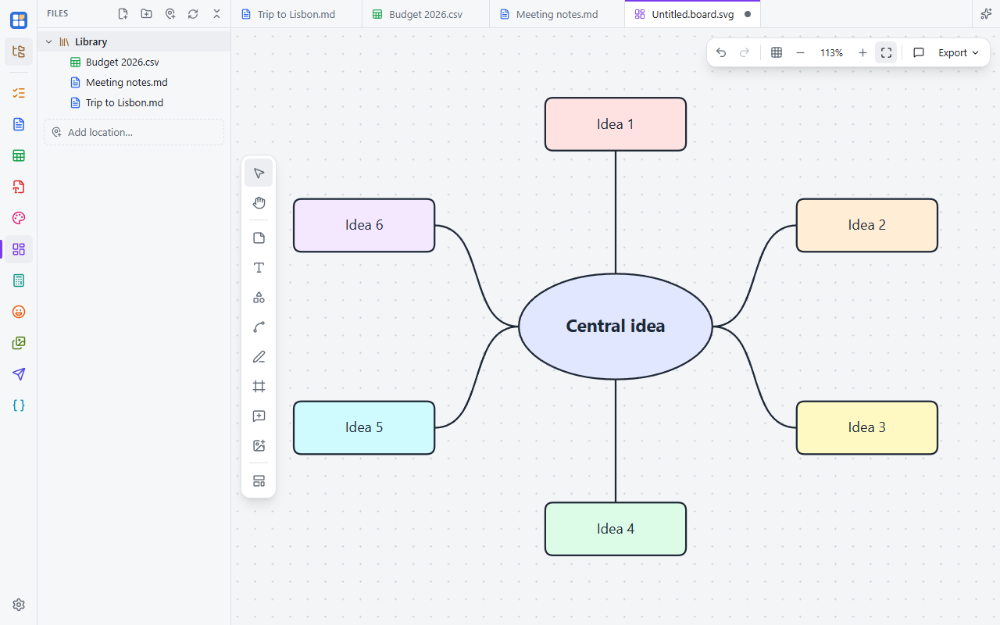

A whiteboard for diagrams, plans and brainstorms. A board is saved as a `.board.svg` file: a normal SVG picture that
any web browser opens, with the editable board inside it. Send the single file to someone and they can keep editing it
in Simple Desk.

## Tools

The rail on the left: **Select** (V), **Hand** (H, or hold Space), **Sticky note** (N), **Text** (T), **Shapes** (S, 18
of them), **Connector** (L), **Pen** (P), **Frame** (F) and **Add image**.

- Double-click empty space for a sticky note, or anything to edit its text.
- Hover a shape and drag one of its dots to connect it to another. Connectors stay attached when you move things, and
  can be straight, elbow or curved, with arrowheads and labels (double-click a connector).
- Smart guides help line things up while you drag; there's also a grid with snapping.
- Align, distribute, change the stacking order, and lock items.
- **Ctrl+C / V / D** copy, paste and duplicate, even between boards. Paste or drop pictures straight onto the board.

The mouse wheel pans; **Ctrl+wheel** zooms.

## Templates

**Start from a template** on an empty board, or the templates button on the rail: flowchart, kanban, mind map,
retrospective, SWOT, brainstorm, weekly plan and org chart. Save any selection as your own template to reuse it.

## Comments

Press **C** and click anywhere, or on an item, to start a comment thread (it follows the item when moved). Reply,
resolve, and browse all threads in the Comments panel. Comments travel inside the `.board.svg` but never show in
exported pictures. Your name on comments is set in **Settings → General**.

## Export

**Export** saves a PNG of the whole board, the selection or a frame, or a plain SVG.
