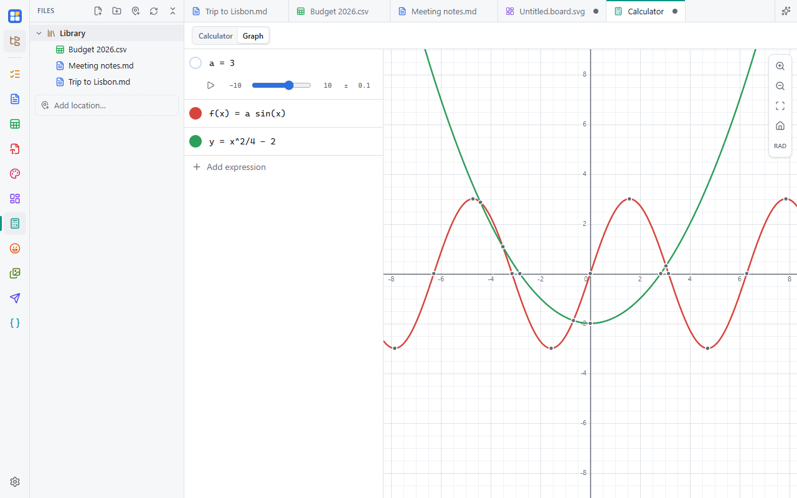

One app with two modes: a scientific **Calculator** and a **Graph**. Turn it on in **Settings → Apps**.

## Calculator

Type a whole line, like `2 sin(30) + √5`, and see the result as you type. **Enter** adds it to the history.

- **↑ / ↓** recall earlier lines; `ans` is the last result.
- Define variables and functions, like `r = 4` or `f(x) = x^2 + 1`. They're kept between sessions.
- **DEG / RAD** for angles. Show results as decimals, fractions (a/b), scientific notation, hex or binary.
- Units and conversions: `5 ft to m`.
- `0xff` and `0b101` literals, `ln`, `log` (base 10) and `log(x, b)`.
- The keypad (with **2nd** and **hyp**) inserts at the cursor. On a phone it switches between numbers and functions.

**Graph it** sends a line that uses `x` to the graph.

## Graph

A list of lines on the left, the plot on the right.

- `y = …`, `f(x) = …` or any expression in `x` plots a curve; `x = 3` draws a vertical line.
- `a = 2` makes a **slider**: drag it, set its range and step, or press play to animate. Any letter you haven't defined
  offers **Add slider**.
- Zeros, maxima and minima, y-intercepts and intersections are marked. Hover or tap one for its coordinates (click to
  pin it), or hover a curve to trace it.
- `f'(x)` and `f''(x)` plot derivatives, shown symbolically.
- A line's **⋯** menu shades the area under it between two bounds (with its value), adds a tangent line with its slope,
  or plots its derivative.

Wheel zooms around the cursor (**Shift**: x only, **Alt**: y only), drag pans, and pinch works on touch screens. With the
graph focused, the arrow keys pan, **+ / −** zoom and **0** resets.

Save a graph as a `.graph.json` file: one readable file with its lines, sliders and view.
