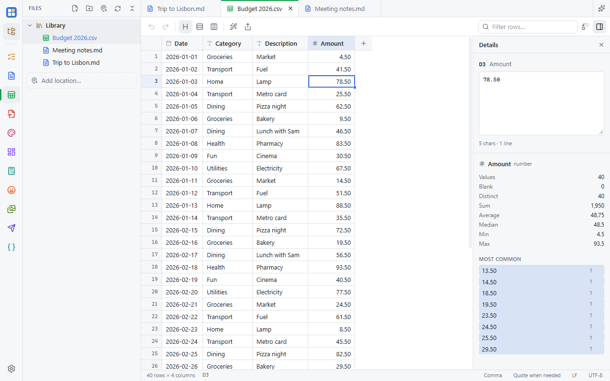

A spreadsheet-style editor for `.csv` and `.tsv` files. It handles large files smoothly and keeps your file's format:
the delimiter, quoting, line endings and encoding are detected and kept, so a file you open and save without changes
stays byte for byte the same. It also opens Excel (`.xlsx`) and OpenDocument (`.ods`) workbooks; see
[below](#excel-and-opendocument-workbooks).

## Editing

- Type to replace a cell; **Enter** and **Tab** move down and right. **Alt+Enter** adds a line break inside a cell.
- **Ctrl+C / X / V** copy and paste as tab-separated text, so you can paste to and from Excel or Google Sheets.
- **Ctrl+D** / **Ctrl+R** fill down / right. Drag the small square at the corner of a selection to fill: series like
  `1, 2…` or `2024-01-30, 2024-01-31…` continue, anything else repeats.
- **Ctrl+F** finds, **Ctrl+H** replaces. **Ctrl+Z / Ctrl+Y** undo and redo.
- Right-click for sorting and inserting or deleting rows and columns.

## Sorting and filtering

Sorting only changes the view, so saving keeps the file's row order. To write the sorted order into the file, click
**Apply to file** in the sort chip (Ctrl+Z undoes it). **Then sort by** in a column's menu adds tie-breakers.

The filter box at the top shows only matching rows. A column's menu also has **Filter by value…**.

## Columns and rows

- Freeze columns from the column menu. Column widths and frozen columns are remembered per file.
- Drag a selected column's header to move it; drag selected row numbers to move rows (when not sorted).
- **Split** a column on a separator, or **merge** several into one.

## Clean up

The wand in the toolbar works on the selection: trim extra spaces, change case, and remove duplicate rows.

## Details

The panel button on the right opens **Details**: a roomy editor for the selected cell, plus its column's counts,
blanks, distinct values, sum, average, median or date range, and most common values. Click a value to filter by it.

The status bar shows the sum and average of the selection, and lets you change the delimiter, quoting, line endings
and encoding.

## Rows that don't fit

Rows with a different number of fields than the rest are flagged. The warning in the status bar jumps between them and
can pad short rows.

## Excel and OpenDocument workbooks

`.xlsx` and `.ods` files open with a tab for each sheet at the bottom. Everything above works on the sheet you're on.

Workbooks are edited as values: dates show as `2025-01-31`, and formulas show their last result. When you save over a
workbook, only the sheets you edited are rewritten, as plain values, so their formatting, formulas and charts are lost.
The first save asks before it does this, and offers **Save a copy…** instead. Sheets you didn't edit are kept exactly as
they were.

**Save As** offers Excel workbook and OpenDocument spreadsheet after CSV and TSV. Saving a workbook as CSV saves the
sheet you're on. Old `.xls` files aren't supported: save them as `.xlsx` in Excel first.

## Export

The share button in the toolbar (or right-click) copies the selection or the whole visible table as a Markdown table or
JSON, or saves it as `.md` or `.json`.
