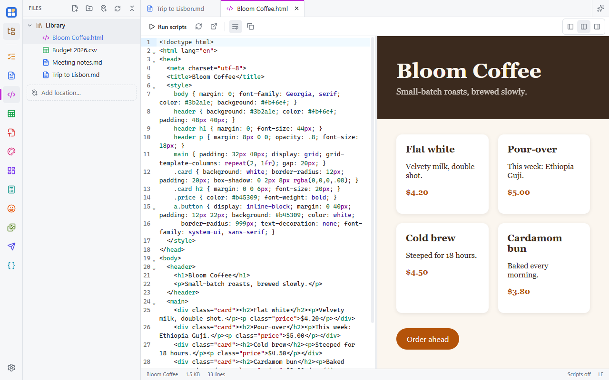

An editor for web pages. It opens `.html`, `.htm` and `.xhtml` files in a code editor, with the page rendered beside it.
The app draws the page itself, so there's no extra browser to install. Turn it on in **Settings → Apps**.

## Code, split or preview

The buttons at the top right switch between **Code only**, **Split** and **Preview**. A page you open starts in Preview,
and a new file starts in Split. The preview catches up with your typing after a short pause and keeps its scroll
position. On a phone there's no Split: switch between the code and the page.

The editor highlights HTML, including the CSS and JavaScript inside it. **Wrap lines** and **Copy** are in the toolbar.
The status bar shows the page's title, its size, the number of lines, and whether scripts are on.

Stylesheets, pictures and scripts that sit next to the file load as they would in a browser, so a page with a
`style.css` and an `img` folder looks right. This works in the desktop app.

## Scripts are off until you turn them on

A page's JavaScript doesn't run until you click **Run scripts**. This keeps HTML files from other people harmless:
opening a page can't run code. The setting is per tab.

With scripts on, the page runs in a sandbox. It can't reach the app or your files.

## Links

With scripts off:

- `#anchor` links scroll within the page;
- web and email links open in your browser;
- links to files next to the page open them in their app, and another `.html` page opens in a new tab.

With scripts on, links navigate inside the preview, as they would in a browser. **Reload preview** brings your page
back.

## Open in a browser

**Open in browser** shows the saved file in your default browser. It's there once the file is saved and has no
unsaved changes.

## AI

The [AI sidebar](/docs/ai/sidebar/) and [connected agents](/docs/ai/agents/) edit HTML like any text file. Their
changes appear live with their name on the cursor, and [Show](/docs/ai/activity/#showing-a-change) takes you back to
them later.
