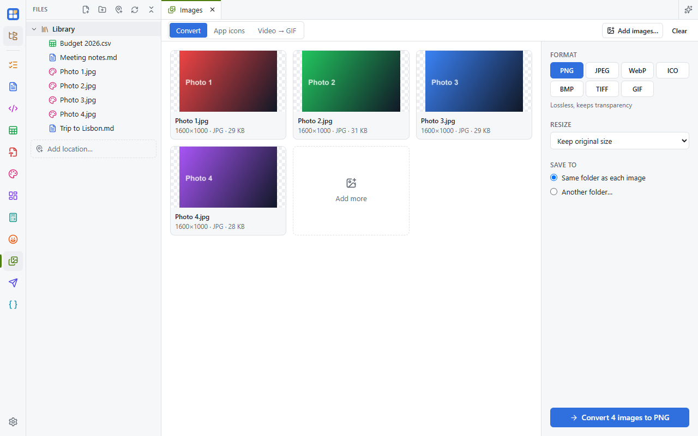

Batch image conversion, icon sets and video-to-GIF. Turn it on in **Settings → Apps**, then right-click pictures in
the Files panel → **Open in Images**. All your images go into one Images tab.

## Convert

Convert to PNG, JPEG, WebP (lossy with a quality setting, or lossless), ICO (16 to 256 px), BMP, TIFF or GIF, and resize
by fitting in a box, to an exact size, or by percent. SVG files are rendered crisply at the size you ask for.

Files are converted side by side and never overwrite anything: a name that's taken gets a number, like
`photo (1).png`.

## App icons

From one picture, make a complete icon set: a Windows `.ico`, a website favicon set (with the `<link>` tags to paste),
PWA icons (including maskable), Apple touch icons, a macOS `.icns`, Android mipmaps, or a Tauri icon set. Add padding,
a background color and rounded corners.

## Animations

Animated GIF and WebP pictures show their frame count. Converting to GIF or WebP keeps the animation (resizing applies
to every frame). Converting to a still format keeps the first frame, or the one you pick with **Frame N of M…**.

## Video to GIF

Open or drop an MP4, WebM or MOV. Drag the handles on the filmstrip, or type start and end times, to pick up to 30
seconds. Choose GIF or WebP, the frame rate and the width, and the animation is saved next to the video.

The video is decoded by your system's web view, so formats it can't play (AVI, MKV, WMV, or MP4 without H.264) show a
message instead.
