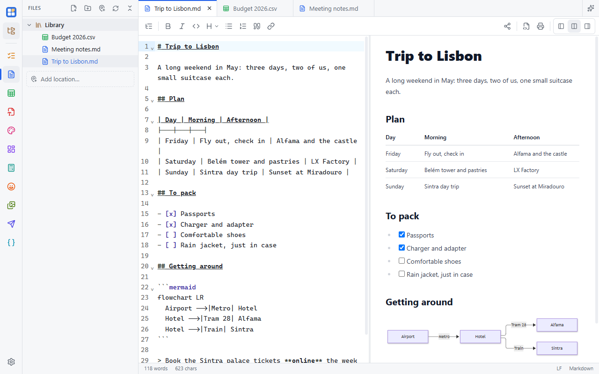
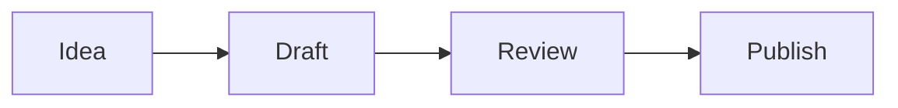

A Markdown editor with the text and a live preview side by side, an outline, Mermaid diagrams, and export to HTML or
PDF. Files are plain `.md`, so they open anywhere.



## Text, preview, or both

The buttons at the right of the toolbar show the text editor, the preview, or both side by side. The outline button at
the left lists the headings; click one to jump there.

## Type in either pane

You can edit in the preview as well as in the text:

- Click into the preview and type. **Enter** starts a new paragraph, **Backspace** at the start joins it to the one
  before.
- Use the toolbar or **Ctrl+B**, **Ctrl+I** and **Ctrl+E** (inline code) in either pane. The heading menu sets the line
  to Heading 2, 3 or 4, or back to normal text.
- Tick task-list checkboxes (`- [ ]`) right in the preview.
- Links in the preview are text you can edit; **Ctrl+click** opens them.

Every change is written to the Markdown, so undo, save and the text editor stay in step. Only the paragraphs you edit
are rewritten; the rest of the file stays exactly as it was.

## Lists

In the text editor, press **Enter** at the end of a list item to start the next one: `- ` again, or the next number in
a numbered list. A task item (`- [x]`) starts a new empty box. Press **Enter** on an empty item to end the list.

## Paste pictures

Copy a picture (a screenshot, or an image from a web page) and press **Ctrl+V** in either pane. Simple Desk saves it in
a hidden `.pasted-images` folder next to the document and adds a link to it, like
``, so the picture also shows in other Markdown editors.

Delete the picture from the document and save, and its file goes to the Recycle Bin, unless another Markdown file in the
same folder still uses it. Until you save, **Ctrl+Z** brings it back.

## Diagrams

A code block that starts with ` ```mermaid ` shows as a [Mermaid](https://mermaid.js.org) diagram in the preview:
flowcharts, sequence, class and state diagrams, Gantt charts, pie charts and more.

````md

````

Click **Edit** on the diagram (or double-click it) to change its code in place. It redraws as you type and shows
Mermaid's error message if the code is invalid.

## Export and print

The toolbar exports the document as an HTML file or prints it (choose "Save as PDF" in the print dialog to make a PDF).
Diagrams are included as pictures.

## Sharing

The people button in the toolbar shares the document for [live editing with others](/docs/sharing/live-sharing/).
