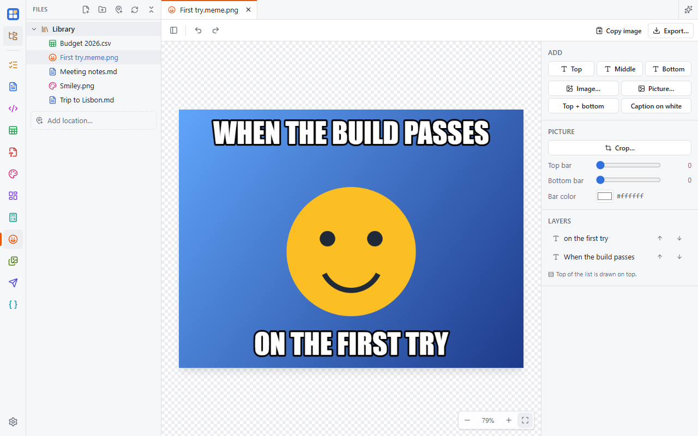

Make memes from popular templates or your own pictures. Turn it on in **Settings → Apps**.

## Start a meme

- Pick one of [Imgflip](https://imgflip.com)'s popular templates (searchable; the list is cached so it shows offline
  too),
- open or paste a picture (**Ctrl+V**), or drop one on the canvas,
- or right-click any picture in the Files panel → **Open in Meme Maker**. That starts a new meme and never changes the
  original.

## Text

Classic white Impact text with a black outline is added at the top and bottom. Double-click a box to type in it.

- Drag to move (it snaps to the center line). Side handles set the wrap width, corner handles scale, the round handle
  rotates (**Shift** snaps to 15°).
- The right panel sets the font (your system fonts plus Anton, Bebas Neue, Oswald and Permanent Marker), size, ALL CAPS,
  bold, alignment, fill, outline, letter spacing and line height. New boxes reuse your last font and colors.
- **Caption on white** adds a bar above the picture with plain black text. Top and bottom bars can be any height and
  color.

## Stickers and crop

Add **images** on top: move, scale, rotate, flip and fade them. **Crop** never throws anything away (Free, Original,
1:1, 4:5, 16:9, 9:16).

## Saving and sharing

A meme saves as `name.meme.png`: a normal PNG of the finished meme that any app or chat shows, with the editable layers
stored inside it, so it reopens fully editable.

**Export…** writes a plain PNG, JPEG or WebP, optionally smaller. **Copy image** (**Ctrl+Shift+C**) puts it on the
clipboard, ready to paste into a chat.
