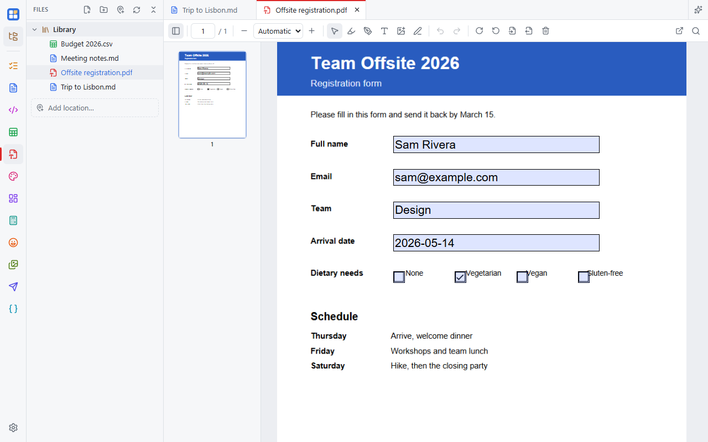

A PDF viewer and editor: read and search, fill forms, highlight, draw, sign, and rearrange pages.

## Reading

- Thumbnails and the document outline in the side panel.
- Zoom with **Ctrl +/−/0** or **Ctrl+wheel**; find text with **Ctrl+F**.

## Marking up

- **Fill forms** by typing in the form fields.
- **Highlight** text, **draw**, and add **text boxes** and **images**.
- **Sign**: draw, type or upload a signature. Signatures are saved for reuse.

All of these are saved as real PDF annotations, so other PDF readers show them too.

## Pages

- **Rotate** or **delete** pages.
- **Extract** pages to a new PDF, or **insert** another PDF.
- **Reorder** by dragging thumbnails.
- **Flatten forms**, turning filled-in fields into ordinary page content.

**Ctrl+Z** undoes annotation edits, then page changes.

## Saving

The first time you save, Simple Desk asks whether to overwrite the original or save a copy.
