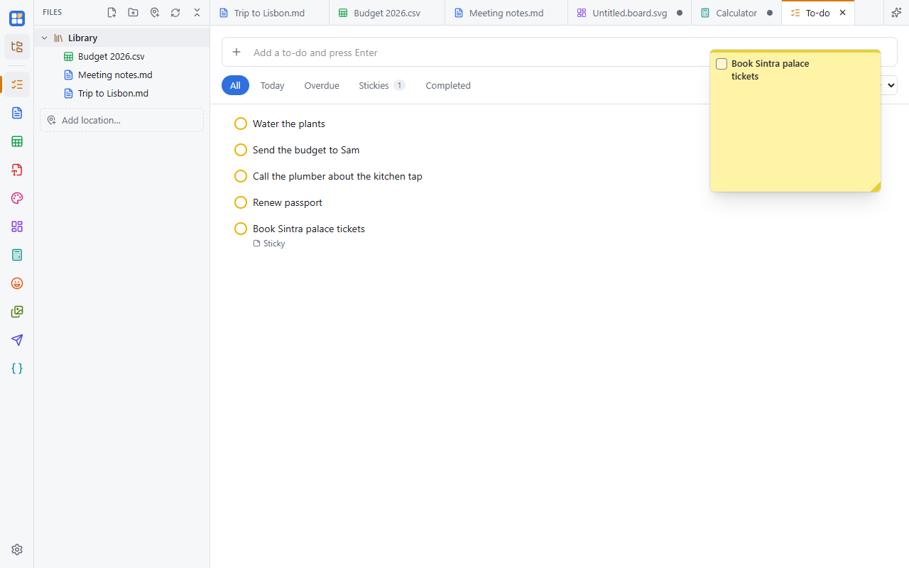

One to-do list with due dates, reminders, priorities and subtasks. Any item can float as a sticky note, inside the app
or right on your desktop. Turn it on in **Settings → Apps**.

## Adding and organizing

- Type in the box at the top and press **Enter** to add a to-do.
- Click a to-do to open its details: **due** date and time, **priority**, **color**, **subtasks** and **notes**.
- Drag to-dos to reorder them, or pick a sort order.
- Filters: **All**, **Today**, **Overdue**, **Stickies** and **Completed**.

## Reminders

A to-do with a due date reminds you with a system notification at the due time, or at 9 AM for a date without a time.
On Android, reminders are scheduled with the system, so they arrive even when the app is closed.

## Sticky notes

In a to-do's details, set **Sticky note** to:

- **In app**: a note that floats over every tab.
- **On desktop**: its own small window on your desktop, optionally always on top. It remembers where you put it and
  comes back the next time you start Simple Desk.

Tick items and subtasks right on the note. If you turn the To-do app off, its reminders and sticky notes keep working.

## Where to-dos are stored

To-dos live in the app's settings on each device, not in your library, so they don't follow your files to another
computer.
