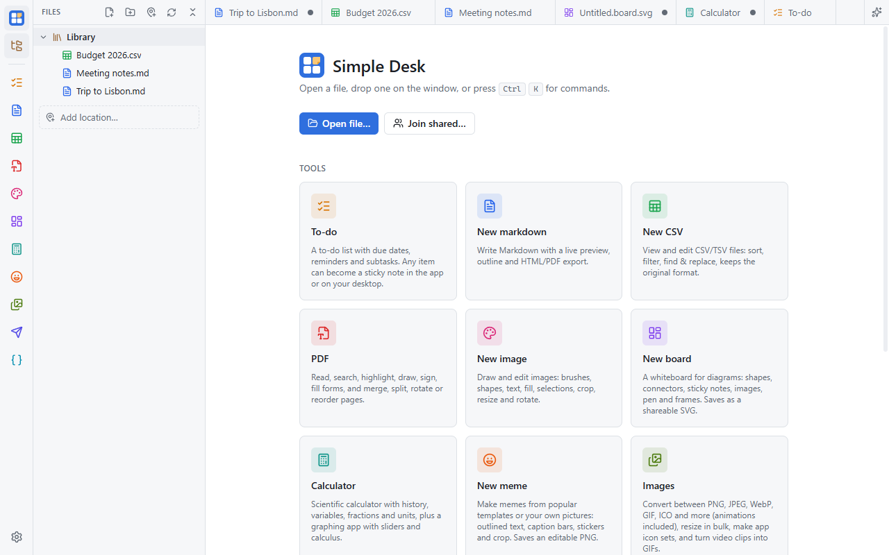

import { CardGrid, LinkCard } from "@astrojs/starlight/components";
import { url as siteUrl } from "../../../lib/url";

Simple Desk is a free office suite for Windows, macOS, Linux and Android. It puts a set of small, fast apps in one
window: Markdown, CSV, PDF, Paint, a whiteboard, a graphing calculator, a to-do list with sticky notes, a meme maker,
image conversion, an API client and a JSON editor.

Everything you make is an ordinary file in a folder on your computer. There's no account, no subscription, and
nothing is tracked.

## How it fits together

- **Home** shows a card for each app. Click one to start a new document, or open a file you already have.
- **Tabs** along the top hold your open documents, each in its own app, colored like the app.
- The **Files panel** on the left shows your library folder and any other folders you add.
- **Ctrl+K** opens the command palette: every command, app and recent file, searchable.
- **Settings** (the gear at the bottom left, or Ctrl+,) has the theme, which apps to show, your library location,
  AI, sharing and updates.

## Start here

<CardGrid>
  <LinkCard title="Install" href={siteUrl("docs/install/")} description="Windows, macOS, Linux and Android, including the first-launch warnings." />
  <LinkCard title="First run" href={siteUrl("docs/first-run/")} description="Your library, the Files panel, and choosing your apps." />
  <LinkCard title="Opening and saving files" href={siteUrl("docs/files/")} description="Which app opens what, drag and drop, and saving." />
  <LinkCard title="Keyboard shortcuts" href={siteUrl("docs/shortcuts/")} description="The shortcuts worth learning first." />
</CardGrid>
