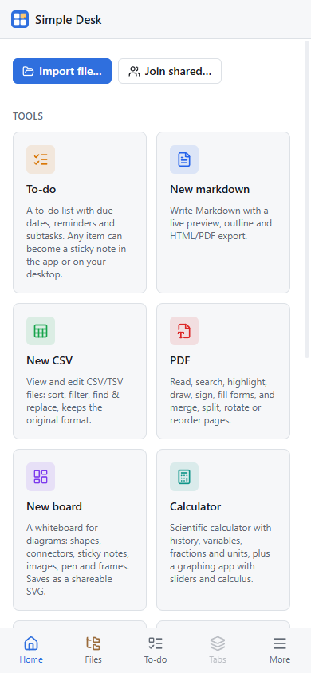

Simple Desk runs on Android phones and tablets, from the same app as the desktop version. Install it from the
[download page](/download/) (see [Install](/docs/install/)).

## Getting around

On a phone the app uses a compact layout with a bottom bar: **Home**, **Files**, **To-do**, **Tabs** and **More**. Files
opens a full-screen file list, and Tabs switches between open documents.

## Files on a phone

Your files live in the app's own library. **Import file…** copies a file in from the system picker, and saving a new
document writes it into the library.

## What works

- **To-do**, **Markdown**, **PDF** and the **Calculator** are tuned for touch. To-do reminders are scheduled with
  Android, so they arrive while the app is closed.
- **CSV**, **HTML**, **Board**, **Meme Maker**, **JSON** and the **API client** open as they are.
- **Paint** and **Images** aren't offered on phones yet.
- [Live sharing](/docs/sharing/live-sharing/) works: scan a share's QR code with the phone to join.
- AI keys can't be stored on Android yet, and agents (MCP) are desktop only.

## Updates

When a new version is out, an icon appears in the header. **Download and install** fetches it, and Android asks you to
confirm (the first time, allow Simple Desk to install apps).
